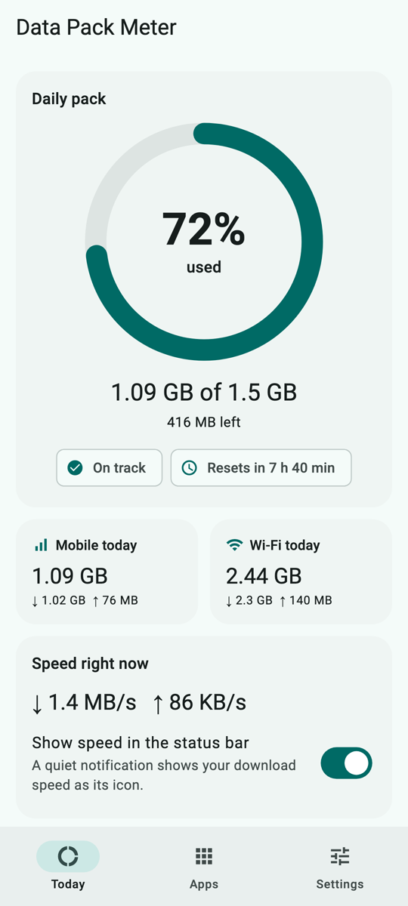
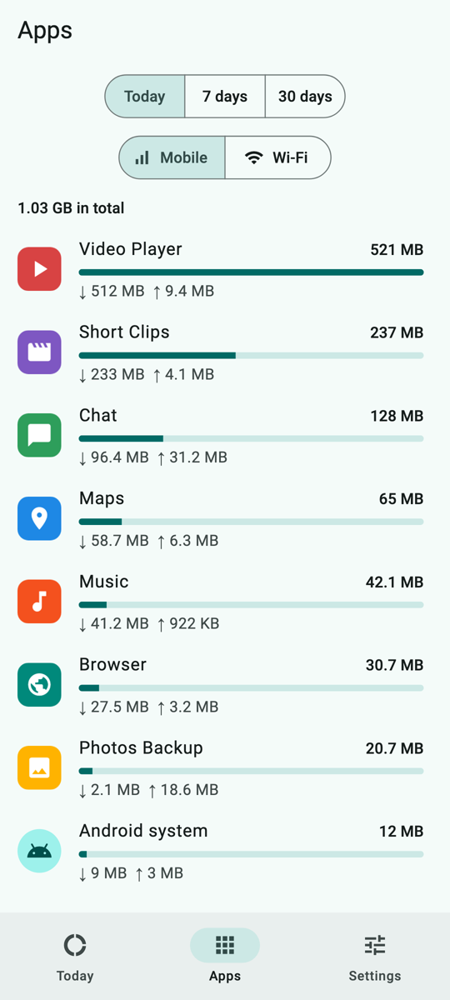
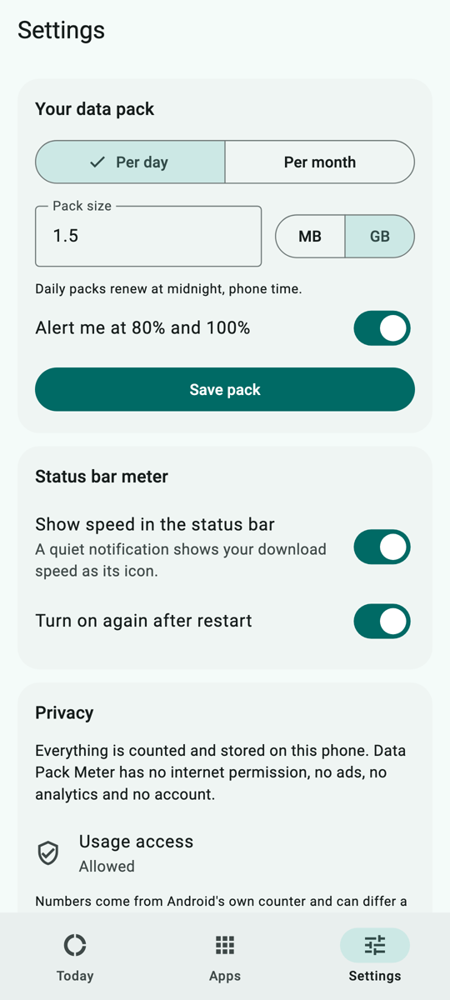
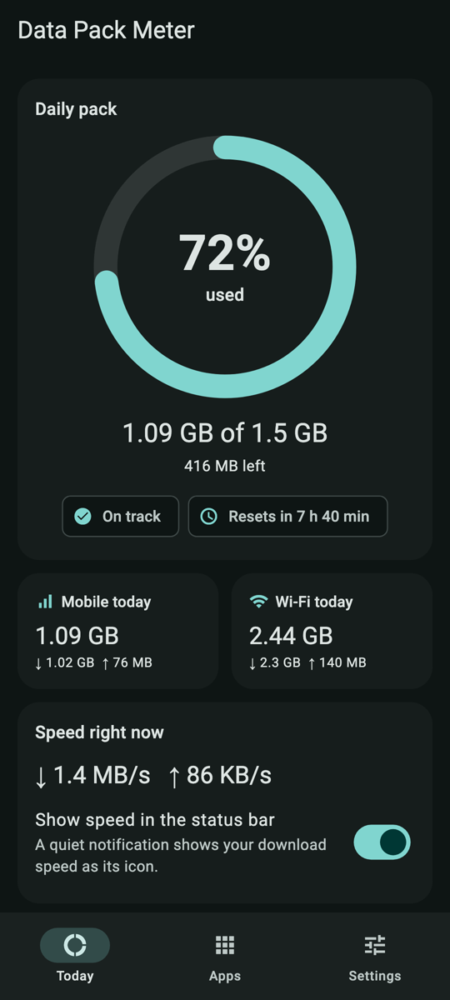

# Data Pack Meter

[](https://github.com/ChandraChaan/data-pack-meter/actions/workflows/ci.yml)
[](https://github.com/ChandraChaan/data-pack-meter/releases/latest)
[](LICENSE)


**Know how much of today's data pack is left, and see your speed in the status bar.**

Many mobile plans give you a fixed amount a day, like 1.5 GB or 2 GB, and quietly slow you down when it runs out. Data Pack Meter tells you where you stand: how much of the pack you've used, how long until it renews, which apps are eating it, and how fast you're downloading right now.

It runs entirely on your phone. The app has no internet permission, no ads, no analytics and no account.

<p>
  
  
  
  
</p>


*The meter icon in the status bar, from an Android 17 emulator.*

## Download APK

Get the latest build from **[Releases](https://github.com/ChandraChaan/data-pack-meter/releases/latest)**:

| File | For |
| --- | --- |
| [`data-pack-meter-arm64-v8a.apk`](https://github.com/ChandraChaan/data-pack-meter/releases/latest/download/data-pack-meter-arm64-v8a.apk) | Almost every phone from the last 6+ years. Pick this one if unsure. |
| [`data-pack-meter-armeabi-v7a.apk`](https://github.com/ChandraChaan/data-pack-meter/releases/latest/download/data-pack-meter-armeabi-v7a.apk) | Older 32-bit phones. |
| [`data-pack-meter-universal.apk`](https://github.com/ChandraChaan/data-pack-meter/releases/latest/download/data-pack-meter-universal.apk) | Any phone; larger download. |

Each release lists SHA-256 checksums in `SHA256SUMS.txt`. To check a download:

```bash
sha256sum -c SHA256SUMS.txt --ignore-missing
```

Android will ask you to allow installs from your browser or file manager the first time. Needs Android 8.0 or later.

## What it does

- **Speed in the status bar.** Turn on the meter and a quiet notification shows your current download speed as its icon (`1.2 MB/s`), with download and upload speed in the notification itself. It updates once a second while the screen is on and sleeps while it's off. It can come back on by itself after a restart.
- **Your pack, at a glance.** Set a daily pack (renews at midnight) or a monthly one (renews on the day you choose; in shorter months, the last day). A ring shows how much is used, what's left and how long until it renews.
- **Alerts at 80% and 100%.** Once each per pack period, checked in the background every 15 minutes (every minute while the meter is on).
- **Which apps use it.** Per-app use for today, 7 days or 30 days, for mobile data and Wi-Fi separately, with app names and icons.

## How it works

| Piece | Where it comes from |
| --- | --- |
| Live speed | Android's [`TrafficStats`](https://developer.android.com/reference/android/net/TrafficStats) byte counters, sampled once a second. The difference between two samples is the speed. |
| Pack use and per-app use | Android's own data usage log, [`NetworkStatsManager`](https://developer.android.com/reference/android/app/usage/NetworkStatsManager). This is the same record the system's Data usage screen uses. |
| Status bar icon | The speed is drawn into a small bitmap each second and set as the notification's icon. |
| Alerts | A WorkManager job every 15 minutes, plus a check every minute while the meter runs. |

The Flutter UI talks to Kotlin through one platform channel, behind Dart repository interfaces, so the screens and the pack logic (renewal dates, time zones, units, alert levels) are unit-tested with fakes. The Kotlin side has its own JVM tests for speed sampling, byte counting and formatting.

**Units:** 1 GB = 1024 MB, the way carriers count packs.

**Accuracy:** the numbers come from Android, not your carrier. Android stores usage in time buckets, so a figure around midnight can include a few minutes either side, and carriers may round differently. Treat it as a close guide.

## Permissions

| Permission | Why |
| --- | --- |
| **Usage access** (`PACKAGE_USAGE_STATS`) | Android only shares its data usage log with apps the user allows. You turn it on yourself in **Settings → Usage access**; the app explains this before sending you there. Without it the speed meter still works, but pack tracking and the app list can't. |
| Notifications (`POST_NOTIFICATIONS`) | The status bar meter and the 80% / 100% alerts. |
| Foreground service (`FOREGROUND_SERVICE`, `FOREGROUND_SERVICE_SPECIAL_USE`) | Keeps the meter running while you use other apps. Declared as a special-use service: a live status bar indicator the user turned on. |
| Run at startup (`RECEIVE_BOOT_COMPLETED`) | Brings the meter back after a restart, only if you turned that on. |
| `WAKE_LOCK`, `ACCESS_NETWORK_STATE` | Added by Android's WorkManager library to run the background pack check. |

There is **no `INTERNET` permission**: the app cannot send anything anywhere. Android's backup of app data is turned off as well.

## Privacy

Data Pack Meter reads byte counts from Android and keeps your pack settings on the phone. It has no server, no account, no ads, no analytics and no crash reporting, and it can't reach the internet. Uninstalling it removes everything it stored.

## Build it yourself

You need Flutter 3.44 and JDK 17.

```bash
flutter pub get
flutter test
flutter build apk --release --split-per-abi
```

Without `android/key.properties` the release build is signed with the debug key. Kotlin unit tests:

```bash
cd android && ./gradlew :app:testDebugUnitTest
```

The README screenshots are rendered from the real screens with sample data: `flutter test tool/screenshots --update-goldens`.

Project layout and coding rules are in [AGENTS.md](AGENTS.md).

## License

[MIT](LICENSE) © Chandra ObulaReddy
